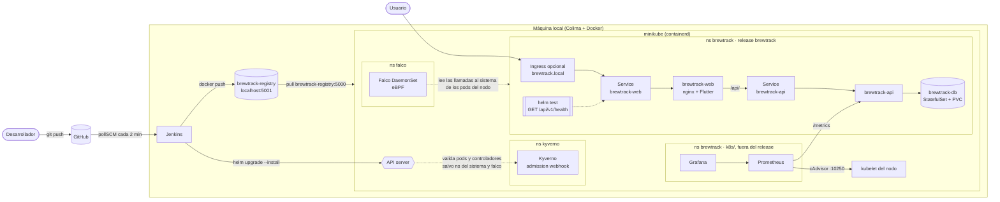
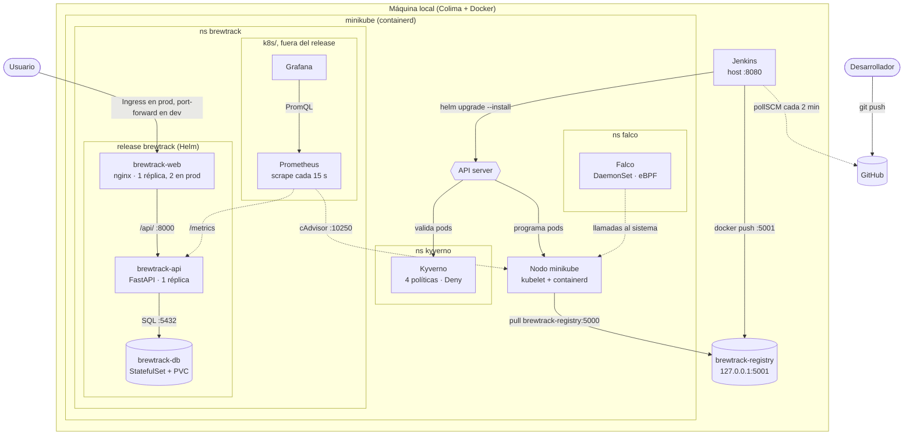
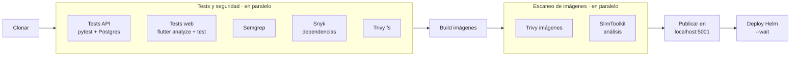

# BrewTrack

Trazabilidad de café de especialidad: lotes de café verde y tuestes. API FastAPI + frontend Flutter Web + PostgreSQL, empaquetados en contenedores y desplegados en Kubernetes con Helm, Jenkins, Prometheus, Grafana, Kyverno y Falco.

Este README es también el **informe técnico del Laboratorio 4**. Sigue los apartados que pide la consigna:

1. [Descripción general del proyecto](#1-descripción-general-del-proyecto)
2. [Arquitectura final](#2-arquitectura-final)
3. [Pipeline implementado](#3-pipeline-implementado)
4. [Métricas y dashboard de Grafana](#4-métricas-y-dashboard-de-grafana)
5. [Resultados de los análisis de seguridad](#5-resultados-de-los-análisis-de-seguridad)
6. [Problemas encontrados y soluciones adoptadas](#6-problemas-encontrados-y-soluciones-adoptadas)
7. [Conclusiones y oportunidades de mejora](#7-conclusiones-y-oportunidades-de-mejora)

Al final están el [paso a paso para levantar todo](#paso-a-paso) y el [uso local con Docker Compose](#uso-local-con-docker-compose).

> **Estado de la evidencia.** Los resultados de Semgrep, pip-audit y los tests son de corridas reales. Los de Helm, Jenkins, Kyverno, Falco, Snyk y Grafana salen al correr los scripts en minikube; donde todavía no están, el texto dice _pendiente_ y qué comando los genera.

---

## 1. Descripción general del proyecto

BrewTrack lleva el registro de un taller de tueste, desde que llega el café verde hasta que sale tostado.

- **Lotes de café verde:** cada lote guarda su origen (país, región, finca, productor), variedad, proceso, altitud, cosecha y los kg recibidos.
- **Tuestes:** cada tueste anota de qué lote sale, quién lo hizo, cuánto verde entró y cuánto tostado salió, la duración, la temperatura de descarga y el nivel (`light`, `medium`, `dark`). La merma se calcula sola.
- **Stock:** la app no lo guarda, lo calcula: kg recibidos menos el verde usado en los tuestes. No deja tostar más de lo que queda.
- **Trazabilidad:** desde un lote se ven todos sus tuestes, y desde un tueste se llega a su lote de origen.
- **Resumen mensual:** cuánto verde queda hoy y, para el mes elegido, cuánto se recibió, cuánto se tostó y con qué merma.
- **Usuarios y roles:** `roaster` registra lotes y tuestes; `admin` además borra y gestiona usuarios. Un admin crea las cuentas.

Fuera de alcance: curvas de tueste, empaque, precios, clientes y facturación, recetas y cata, y varias empresas en una misma instalación.

| Componente | Tecnología | Imagen |
|---|---|---|
| `web` | Flutter Web servido por nginx (hace de proxy de `/api/` a la API) | `brewtrack-web:0.2.0` (UI actual; `0.1.0` es la anterior) |
| `api` | FastAPI, SQLAlchemy 2, Alembic, Python 3.13 | `brewtrack-api:0.1.0` |
| `db` | PostgreSQL 17 | `brewtrack-db:0.1.0` |

**Qué agrega este laboratorio**

| Punto de la consigna | Dónde está |
|---|---|
| 1. Contenedores | `api/`, `web/` y `db/` con su `*.Containerfile` (equivalen a un Dockerfile); análisis en `reports/image-analysis.md` |
| 2. Kubernetes + Helm | `helm-chart/` (`values.yaml`, `values-dev.yaml`, `values-prod.yaml`) |
| 3. Jenkins | `Jenkinsfile`, `docs/ci/jenkins.md` |
| 4. Prometheus + Grafana | `api/app/metrics.py`, `k8s/prometheus.yaml`, `k8s/grafana.yaml`, `grafana/dashboard.json` |
| 5. Seguridad | `semgrep/`, `kyverno/`, `falco/`, informes en `reports/` |
| Scripts | `scripts/` |

---

## 2. Arquitectura final



**Recorrido de un pedido.** El usuario entra por el Ingress (o por un `port-forward` en dev). nginx (`brewtrack-web`) sirve la UI y reenvía `/api/` al Service `api`. La API lee y escribe en Postgres (`db`), que guarda sus datos en un PersistentVolumeClaim de 1 GiB (10 GiB en prod).

**Nombres por release.** Cada recurso lleva el nombre del release (`brewtrack-db`, `brewtrack-api`, `brewtrack-web`, `brewtrack-secrets`), así que se pueden instalar dev y prod en el mismo clúster, en namespaces distintos. La `DATABASE_URL` y la dirección de la API que usa nginx se arman con esos nombres.

**Seguridad en dos momentos.** Kyverno revisa cada pod, y lo que crea pods, cuando llega al API server, y rechaza los que incumplen. Deja fuera los namespaces del sistema, `kyverno`, `falco` e `ingress-nginx`. Falco mira lo que hacen los pods ya en marcha.

**Medidas comunes a todos los pods de la app:**
- Usuario sin privilegios (`runAsNonRoot`, uid numérico).
- Raíz de solo lectura; las carpetas que se escriben son discos en memoria (`emptyDir`).
- Sin escalada de privilegios y sin capabilities (`drop: ALL`).
- `seccompProfile: RuntimeDefault`.
- Sin token de la ServiceAccount, salvo Prometheus, que lo necesita para descubrir pods.
- `requests` y `limits` de CPU y memoria.

### 2.1 Contenedores

| Imagen | Base | Multi-stage | Usuario | Notas |
|---|---|---|---|---|
| `brewtrack-api` | `python:3.13-slim` | Sí: instala en una etapa y copia solo el resultado | `app` (uid 1000) | Quita `pip` y `setuptools` de la imagen final (Trivy los marcaba) |
| `brewtrack-web` | `ghcr.io/cirruslabs/flutter:3.44.0` → `nginx:1.30-alpine` | Sí: compila Flutter y copia solo `build/web` | `nginx` (uid 101) | Escucha en 8080: un usuario sin privilegios no puede usar el 80 |
| `brewtrack-db` | `postgres:17-alpine` | No hace falta | `postgres` (uid 70) | Imagen propia solo para aplicar parches de Alpine |

Todas las versiones están fijas; ninguna imagen usa `latest`, `stable` ni una etiqueta sin versión. Tamaño, capas y optimizaciones: `reports/image-analysis.md` (_pendiente: análisis con Dive_).

### 2.2 Helm Chart

La chart es la de la spec 008 (`specs/008-helm-chart/spec.md`). Para este laboratorio le sumamos lo que piden las políticas de Kyverno:

- `requests` y `limits` por defecto, también en el pod de `helm test`;
- `seccompProfile: RuntimeDefault`, `drop: ALL` y sin el token de la ServiceAccount;
- límites de CPU de 1 núcleo.

```
helm-chart/
├── Chart.yaml              chart brewtrack, appVersion 0.1.0
├── values.yaml             valores por defecto (minikube, imágenes cargadas a mano)
├── values-dev.yaml         una réplica, datos de ejemplo, web por NodePort, sin Ingress
├── values-prod.yaml        2 réplicas de web, más recursos, sin datos de ejemplo, Ingress nginx
├── README.md               valores, instalación por entorno y verificación
├── tests/render.sh         104 controles sobre lo que renderiza la chart
└── templates/
    ├── _helpers.tpl        etiquetas app.kubernetes.io/* y nombre del Secret
    ├── configmap.yaml      zona horaria, datos de ejemplo y dirección de la API para nginx
    ├── secret.yaml         claves al azar que se conservan en cada upgrade (o existingSecret)
    ├── db.yaml             Service + StatefulSet + PVC
    ├── api.yaml            Service + Deployment (1 réplica fija por las migraciones)
    ├── web.yaml            Service + Deployment
    ├── ingress.yaml        Ingress opcional a la web
    ├── test-health.yaml    pod de helm test: GET a /api/v1/health a través de la web
    └── NOTES.txt           cómo entrar después de instalar
```

Parámetros principales de `values.yaml`: imagen, etiqueta y `pullPolicy` de cada componente; `replicas`, tipo y puerto del Service y `resources` de cada uno; `db.persistence`; `api.config` (zona horaria y datos de ejemplo); `existingSecret`; `ingress.*`. La tabla completa está en `helm-chart/README.md`.

| | `values-dev.yaml` | `values-prod.yaml` |
|---|---|---|
| Datos de ejemplo | Sí | No |
| Web | 1 réplica, Service `NodePort` | 2 réplicas, Service `ClusterIP` |
| Ingress | No | Sí, clase `nginx`, host `brewtrack.local` |
| Disco de la base | 1 GiB | 10 GiB |
| db (requests → limits) | 50m/128Mi → 1/256Mi | 250m/256Mi → 1/1Gi |
| api (requests → limits) | 50m/128Mi → 1/384Mi | 200m/256Mi → 1/512Mi |
| web (requests → limits) | 20m/32Mi → 1/64Mi | 100m/64Mi → 1/128Mi |

```sh
helm install brewtrack ./helm-chart -n brewtrack --create-namespace -f helm-chart/values-dev.yaml
helm test brewtrack -n brewtrack           # GET a /api/v1/health a través de la web
kubectl -n brewtrack get pods
bash helm-chart/tests/render.sh            # prueba de la chart sin clúster
```

> _Pendiente: salida de `kubectl -n brewtrack get pods,svc` con los pods en `Running`, salida de `helm test` y captura de la web (`docs/img/helm-pods.png`, `docs/img/web.png`)._

### 2.3 Diagrama de despliegue

Quién publica, quién baja las imágenes y qué corre en cada namespace. Las flechas punteadas son lecturas de monitoreo.



---

## 3. Pipeline implementado

El `Jenkinsfile` corre en cada cambio de `master`. Jenkins consulta el repo cada 2 minutos porque corre en localhost y GitHub no puede avisarle. Si una etapa falla, las siguientes no corren. Requisitos y problemas comunes: `docs/ci/jenkins.md`.



| # | Etapa | Herramienta | Corta el pipeline si… | Deja |
|---|---|---|---|---|
| 1 | Clonar repositorio | git | no puede clonar | commit, autor y mensaje |
| 2a | Tests API | pytest + Postgres 17 | falla un test | `api/pytest.xml` (pestaña *Tests*) |
| 2b | Tests web | `flutter analyze` + `flutter test` | hay errores de análisis o falla un test | log |
| 2c | Semgrep | paquetes `p/python`, `p/security-audit`, `p/secrets`, `p/dockerfile` + reglas propias | hay cualquier hallazgo | `reports/semgrep-report.txt` |
| 2d | Snyk dependencias | Snyk CLI | hay una vulnerabilidad **crítica** | `reports/snyk-report.txt` |
| 2e | Trivy fs | Trivy (vulnerabilidades, secretos, configuración) | HIGH o CRITICAL con arreglo publicado | log |
| 3 | Build imágenes | `docker build` | falla una compilación | tamaño de cada imagen |
| 4a | Trivy imágenes | Trivy | HIGH o CRITICAL con arreglo publicado | `reports/trivy-images-report.txt` |
| 4b | SlimToolkit análisis | `slim xray` de `db`, `api` y `web` | nunca (amarillo si falla) | `reports/slimtoolkit/` |
| 5 | Publicar imágenes | `docker push` al registro local | el registro no responde | imágenes etiquetadas `versión-commit` |
| 6 | Deploy Helm | `helm upgrade --install --wait` y `helm test` | un pod no queda listo en 5 min, o la web no llega a la API | `helm status`, salida del test, historial y pods |

Detalles que importan:

- **Etiquetas por commit.** Cada build publica la imagen con la versión y el commit corto, por ejemplo `brewtrack-api:0.1.0-<commit>`. Con una etiqueta repetida y `imagePullPolicy: IfNotPresent`, el nodo seguiría usando la imagen vieja.
- **Registro local.** Jenkins publica en `localhost:5001` y los pods bajan de `brewtrack-registry:5000`, que es el mismo contenedor en la red de minikube. El deploy lo indica con `--set <componente>.image.repository=brewtrack-registry:5000/brewtrack-<componente>`. `scripts/registry-up.sh` lo levanta y configura containerd del nodo para aceptarlo por HTTP.
- **Paralelo sin `failFast`.** Si Semgrep falla, Snyk y Trivy terminan igual, así se ven todos los problemas en una corrida.
- **Corte por vulnerabilidades críticas.** Semgrep corre con `--error`, Snyk con `--severity-threshold=critical` y Trivy con `--exit-code 1`. Cualquiera de ellos detiene el pipeline antes de construir y desplegar, y el informe queda como artefacto del build.
- **Registros de cada fase.** Las marcas de tiempo, la salida de cada etapa y los informes de `reports/` quedan archivados en cada build.

> _Pendiente: captura de la vista de etapas de una corrida completa en verde (`docs/img/jenkins-ok.png`) y de una corrida detenida por Snyk o Semgrep (`docs/img/jenkins-falla.png`)._

---

## 4. Métricas y dashboard de Grafana

### 4.1 Instrumentación de la API

La API publica `/metrics` en formato Prometheus. Ese endpoint queda fuera de `/api/`, así que nginx no lo expone hacia afuera.

- **Métricas HTTP:** las genera `prometheus-fastapi-instrumentator`. Son `http_requests_total` (por ruta, método y código) y el histograma `http_request_duration_seconds`.
- **Métricas de negocio:** en `api/app/metrics.py`, definidas en la spec 009.

| Métrica | Tipo | Qué mide |
|---|---|---|
| `brewtrack_green_stock_kg` | gauge | Kg de café verde disponibles en todos los lotes. La API lo calcula en cada scrape con una consulta: no se guarda, como manda la regla de stock. |
| `brewtrack_green_lots_with_stock` | gauge | Lotes con stock mayor a cero |
| `brewtrack_roasts_created_total{roast_level}` | contador | Tuestes registrados |
| `brewtrack_roast_green_in_kg_total` | contador | Kg de verde que entraron al tostador |
| `brewtrack_roast_out_kg_total` | contador | Kg de tostado que salieron. Con el anterior da la merma. |

Si la base no responde, `/metrics` sigue entregando las métricas HTTP y omite las de negocio. `api/tests/test_metrics.py` cubre los cálculos y que un tueste rechazado no cuente.

### 4.2 Prometheus

`k8s/prometheus.yaml` despliega Prometheus 3.15.1 con una ServiceAccount de solo lectura y estas dos fuentes:

- **`api`:** cada pod detrás del Service de la API, descubierto con `kubernetes_sd_configs` por la etiqueta `app.kubernetes.io/component=api` de la chart. Sigue funcionando si se agregan réplicas o cambia el nombre del release.
- **`kubernetes-cadvisor`:** CPU y memoria de cada contenedor. Las publica el kubelet y se piden a través del API server. Solo se guardan las series del namespace `brewtrack`.

### 4.3 Dashboard

Grafana 12.4.13 (`k8s/grafana.yaml`) usa Prometheus como fuente de datos y carga el dashboard **exportado en [`grafana/dashboard.json`](grafana/dashboard.json)**: 22 paneles en 4 secciones.

| Sección | Paneles | Consulta principal |
|---|---|---|
| Resumen | API arriba, **pedidos por segundo**, **latencia promedio**, errores 5xx, logins fallidos, stock verde | `sum(rate(http_requests_total{job="api", handler!="/metrics"}[1m]))` |
| Tráfico y latencia | Pedidos por ruta y por código; latencia promedio y p95; latencia por ruta | `rate(http_request_duration_seconds_sum[1m]) / rate(http_request_duration_seconds_count[1m])` |
| Recursos por pod | **CPU por pod**, **memoria por pod** | `sum by (pod) (rate(container_cpu_usage_seconds_total{namespace="brewtrack"}[1m]))` y `container_memory_working_set_bytes` |
| Negocio | **Tuestes** en la última hora, kg tostados en 24 h, **merma**, lotes con stock, stock verde en el tiempo, tuestes por nivel | `100 * (1 - increase(brewtrack_roast_out_kg_total[24h]) / increase(brewtrack_roast_green_in_kg_total[24h]))` |

Las 19 consultas se validaron con un parser de PromQL, y todas las métricas que usan existen en el `/metrics` real de la API.

**Tráfico para llenar los paneles.** `scripts/load.sh` corre unos 5 pedidos por segundo durante 5 minutos: lecturas, un tueste cada 20 pedidos, logins fallidos y 404. En una prueba de 12 segundos contra la API local, con un lote nuevo de 300 kg:

| Resultado | Valor |
|---|---|
| Pedidos | 223 |
| Tuestes nuevos | 11 |
| `brewtrack_roast_green_in_kg_total` | 117 kg |
| `brewtrack_roast_out_kg_total` | 97,339 kg → merma 16,8 % |
| `brewtrack_green_stock_kg` | 183 kg (300 − 117) |

> _Pendiente: captura del dashboard con `load.sh` corriendo (`docs/img/grafana-dashboard.png`) y de `/targets` en Prometheus con `api` y `kubernetes-cadvisor` en UP (`docs/img/prometheus-targets.png`)._

---

## 5. Resultados de los análisis de seguridad

| Herramienta | Qué revisa | Resultado |
|---|---|---|
| Semgrep | Código, Containerfiles, YAML, nginx, secretos | 37 hallazgos → **1** (falso positivo justificado). Además encontró y corrigió un bug real. |
| Snyk | Dependencias de la API | _Pendiente_. Revisión previa con pip-audit: **0** vulnerabilidades conocidas en 36 paquetes |
| Trivy | Repo e imágenes | Sin HIGH ni CRITICAL con arreglo publicado. Riesgo aceptado: `gosu` en `db` |
| Kyverno | Pods al entrar al clúster | 4 políticas en modo Deny. La chart (incluido el pod de `helm test`), Prometheus y Grafana las cumplen. |
| Falco | Pods en ejecución | Detecta la búsqueda de credenciales dentro del pod de la API |

### 5.1 Semgrep

`scripts/semgrep-scan.sh` → [`reports/semgrep-report.txt`](reports/semgrep-report.txt). Detalle de cada hallazgo: [`reports/semgrep-hallazgos.md`](reports/semgrep-hallazgos.md).

- **Reglas de la comunidad** (`semgrep/semgrep-rules`): `python`, `dockerfile`, `yaml`, `generic/nginx`, `generic/secrets`.
- **Reglas propias** (`semgrep/python-security.yaml`), específicas de Python y del stack de la API:

| Regla | Detecta | CWE |
|---|---|---|
| `brewtrack-jwt-decode-sin-verificar` | `jwt.decode` sin `algorithms`, con la firma apagada o aceptando `none` | CWE-347 |
| `brewtrack-sql-armado-con-texto` | SQL con f-string, `%`, `.format` o `+` | CWE-89 |
| `brewtrack-like-sin-escape` | patrones LIKE armados con lo que manda el usuario | CWE-943 |
| `brewtrack-hash-debil-para-claves` | MD5 y SHA-1 | CWE-327 |
| `brewtrack-secreto-en-log` | secretos, contraseñas o tokens en `print` o `log.*` | CWE-532 |

```
===== 1. Prueba de las reglas propias (semgrep --test)
5/5: ✓ All tests passed

===== 2. Escaneo del repo
Ran 698 rules on 153 files: 1 finding.
    web/pubspec.lock
     ❱ facebook-page-access-token
          172┆ sha256: eaac480a…651f   (hash de 64 caracteres, recortado acá)
```

| Hallazgo | Qué hicimos |
|---|---|
| `brewtrack-like-sin-escape` en el filtro de lotes (2 líneas) | **Corregido.** Con `?country=%` la API devolvía todos los lotes. Ahora usa `icontains(…, autoescape=True)`. El test `test_filter_treats_like_wildcards_as_text` fallaba antes y pasa ahora (120 tests en verde). |
| `no-fractional-cpu-limits` (8 líneas) | **Corregido.** Con límites de 0,2 y 0,5 núcleos Kubernetes frenaba los procesos aunque sobrara CPU. Subimos el `limit` a 1 núcleo; los `requests` siguen en 0,05–0,25. |
| `metadata-*` en las reglas propias (93 líneas) | **Corregido.** Agregamos la metadata estándar (`owasp`, `confidence`, `impact`, …). |
| `facebook-page-access-token` en `pubspec.lock` | **Falso positivo.** Es el hash sha256 de un paquete de Dart, no un token. |

### 5.2 Snyk

`SNYK_TOKEN=… scripts/snyk-scan.sh` → `reports/snyk-report.txt`. Análisis y correcciones propuestas: [`reports/snyk-analisis.md`](reports/snyk-analisis.md).

Snyk analiza las versiones exactas que instala la imagen (`pip freeze` después de `pip install ./api`), no los rangos de `pyproject.toml`.

> _Pendiente: resultado de Snyk. Como revisión previa, pip-audit contra la base de vulnerabilidades de PyPI ([`reports/pip-audit-report.txt`](reports/pip-audit-report.txt)):_
>
> ```
> $ pip-audit -r requirements.txt --no-deps -s pypi
> No known vulnerabilities found
> ```

**Correcciones propuestas:**
- Subir el mínimo de la dependencia afectada a la versión arreglada.
- Generar un lockfile con hashes, para que lo que se escanea sea lo que se despliega.
- Pasar la API a una imagen base mínima (distroless o Chainguard) para bajar los 47 avisos de Debian que no tienen arreglo.

### 5.3 Kyverno

`scripts/kyverno-up.sh` instala Kyverno v1.19.2 (chart 3.9.2) y aplica las políticas de `kyverno/policies/`. `scripts/kyverno-validate.sh` prueba los casos de `kyverno/tests/` y escribe `reports/kyverno-validation.log`. Detalle: `docs/security/kyverno.md`.

| # | Política (`ValidatingPolicy`, Deny) | Rechaza |
|---|---|---|
| 01 | `brewtrack-disallow-latest-tag` | imágenes `:latest` o sin etiqueta |
| 02 | `brewtrack-require-requests-limits` | contenedores sin `requests` y `limits` de CPU y memoria |
| 03 | `brewtrack-require-run-as-non-root` | contenedores sin `runAsNonRoot: true` o con `runAsUser: 0` |
| 04 | `brewtrack-disallow-privilege-escalation` | contenedores `privileged` o con escalada de privilegios. Es la política que eligió el equipo, del perfil *restricted* de Pod Security Standards. |

- **Recursos que revisan:** pods y todo lo que crea pods. Un Deployment que incumple se rechaza al crearlo, así que `helm install` falla con el mensaje.
- **Namespaces excluidos:** los del sistema, `kyverno`, `ingress-nginx` y `falco`, porque Falco necesita correr privilegiado.

| Caso de prueba | Esperado |
|---|---|
| `pod-ok.yaml` | admitido |
| `pod-latest.yaml`, `pod-sin-etiqueta.yaml` | rechazado por 01 |
| `pod-sin-limites.yaml` | rechazado por 02 |
| `pod-root.yaml` | rechazado por 03 |
| `pod-privilegiado.yaml` | rechazado por 04 |
| `deployment-malo.yaml` | rechazado por 01 y 02 |

Las expresiones CEL de las políticas se evaluaron fuera del clúster contra los 7 casos, la chart con `values.yaml`, dev y prod, Prometheus y Grafana, y dieron lo esperado en todos. La chart original de la spec 008 no las pasaba: su `values.yaml` y su pod de `helm test` no tenían límites.

> _Pendiente: fragmento de `reports/kyverno-validation.log`. Para cada caso, el log muestra el comando, la respuesta de Kyverno (que incluye el nombre y el mensaje de la política, por ejemplo "runAsUser 0 es root y no está permitido.") y una línea `RESULTADO: rechazado (esperado: rechazado) -> OK`._

### 5.4 Falco

`scripts/falco-up.sh` instala Falco 0.45.2 (chart 9.2.2) con el driver `modern_ebpf` y las alertas en JSON. `scripts/falco-event.sh` dispara el evento y escribe `reports/falco-event.log`. Detalle: `docs/security/falco.md`.

**Evento detectado.** Simula a alguien que consiguió ejecutar comandos dentro del contenedor de la API y busca llaves SSH y credenciales de AWS para saltar a otros sistemas (MITRE ATT&CK T1552). No abre ningún shell: `kubectl exec` corre `find` y `grep` directamente.

| Comando en el pod `api` | Regla de Falco (estable) | Prioridad |
|---|---|---|
| `find / -xdev -name id_rsa` | Search Private Keys or Passwords | WARNING |
| `grep -rl "BEGIN RSA PRIVATE" /etc /srv` | Search Private Keys or Passwords | WARNING |
| `find / -xdev -path "*/.aws/credentials"` | Find AWS Credentials | WARNING |

La API solo corre `uvicorn`, así que un `find` buscando llaves en su contenedor es sospechoso aunque no encuentre nada. Falco avisa en cuanto arranca el proceso.

> _Pendiente: fragmento del resumen de `reports/falco-event.log` (hora, regla, pod, usuario y comando de cada alerta)._

### 5.5 Trivy

Viene de la entrega anterior (`docs/security/revision_seguridad.md`) y sigue en el pipeline:

| Imagen | Antes | Después |
|---|---|---|
| `brewtrack-web` (Alpine) | 1 CRITICAL, 5 HIGH | 0 |
| `brewtrack-api` (paquetes de Python) | 5 HIGH | 0 |
| `brewtrack-api` (Debian) | 48 HIGH | 47 HIGH, ninguno con arreglo publicado |
| `brewtrack-db` (Alpine) | 18 HIGH | 0 |
| `brewtrack-db` (`gosu`) | 1 CRITICAL, 25 HIGH | Riesgo aceptado (`docs/security/2026-11-10-imagen-db.md`) |

---

## 6. Problemas encontrados y soluciones adoptadas

| # | Problema | Solución |
|---|---|---|
| 1 | Los recursos de los YAML viejos (`k8s/*.yaml`: `api`, `db`, `web-blue`, `web-green`) no chocan por nombre con la chart (`brewtrack-*`), pero dejarían una segunda base corriendo. | El pipeline los detecta antes de desplegar y corta con el comando para borrarlos, en vez de borrar datos sin avisar. |
| 2 | Hubo dos Helm charts en ramas paralelas: la de la spec 008 y otra hecha para este laboratorio. Chocaban en `helm-chart/` y en el número de spec. | Nos quedamos con la de la spec 008, que ya estaba aprobada y tiene nombres por release, `helm test` y su propia prueba de render. Le sumamos lo que pide Kyverno y 17 controles nuevos en `tests/render.sh`. Pipeline, Prometheus, scripts y documentación pasaron a sus nombres. La spec de métricas pasó a ser la 009. |
| 3 | Imágenes con la misma etiqueta en cada build (`0.1.0`) y `imagePullPolicy: IfNotPresent`: el nodo seguía corriendo la imagen vieja. | Etiqueta `versión-commit` en cada build (`0.1.0-<commit corto>`). |
| 4 | El registro local habla HTTP y containerd del nodo exige HTTPS. Además, el puerto 5000 lo usan AirPlay en macOS y `flutter run`. | `registry-up.sh` declara el registro en `/etc/containerd/certs.d/brewtrack-registry:5000/hosts.toml`. Publicamos en el 5001 y lo agregamos a la tabla de puertos de `AGENTS.md`. |
| 5 | Las imágenes usaban `flutter:stable`, `nginx:alpine` y etiquetas como `rebranding` o `master`: dos builds del mismo commit podían dar imágenes distintas. | Versiones fijas (`flutter:3.44.0`, `nginx:1.30-alpine`) y números de versión en la web (`0.1.0`, `0.2.0`). Kyverno ahora rechaza `latest` y las imágenes sin etiqueta. |
| 6 | Ningún pod tenía límites de CPU ni de memoria por defecto, tampoco el de `helm test`: al activar la política 02 de Kyverno, se habrían rechazado. | Límites por defecto en la chart (incluido el pod de test), Prometheus y Grafana **antes** de activar las políticas. `tests/render.sh` lo controla. |
| 7 | Kyverno en modo Deny en todo el clúster habría bloqueado los pods del sistema y a Falco, que necesita correr privilegiado. | Excluimos esos namespaces de las cuatro políticas. |
| 8 | Prometheus contaba sus propios pedidos a `/metrics` como tráfico de la API (uno cada 15 s). | Las consultas del dashboard filtran `handler!="/metrics"`. |
| 9 | Los contadores de Prometheus vuelven a cero cuando el pod se reinicia, y el stock no se puede guardar (regla de la constitución). | El stock es un gauge que la API calcula en cada scrape con una consulta a la base. Los contadores se usan solo con `rate()` e `increase()`, que toleran el reinicio. |
| 10 | Semgrep encontró que el filtro de lotes no escapaba los comodines de LIKE: `?country=%` devolvía todo. | `icontains(…, autoescape=True)` más un test de regresión. |
| 11 | Con límites de CPU fraccionarios (0,2 y 0,5), Kubernetes frena el proceso aunque el nodo tenga CPU libre. | El límite pasa a 1 núcleo. La reserva sigue la fijan los `requests`. |
| 12 | El registro de Semgrep (`semgrep.dev`) y Snyk no siempre son accesibles desde el entorno de trabajo. | Las reglas de la comunidad se clonan desde GitHub (`semgrep/semgrep-rules`) y las propias viven en el repo. Para Snyk, pip-audit hace una revisión previa. |
| 13 | Trivy fs revisa la configuración de todo el repo y habría cortado el pipeline con los manifiestos que incumplen a propósito (casos de prueba de Kyverno). | `--skip-dirs kyverno/tests` en la etapa Trivy fs, y `--exclude` del archivo de casos de las reglas de Semgrep. |
| 14 | La API corre `alembic upgrade head` al arrancar: con más de una réplica, varias migraciones correrían a la vez. | `api.replicas` queda en 1 y está anotado en `values.yaml`. La solución de fondo está en las mejoras (sección 7). |
| 15 | El repo tiene finales de línea mezclados: 129 archivos aparecen modificados sin cambios reales. | _Pendiente:_ agregar un `.gitattributes` con `* text=auto eol=lf` y normalizar en un commit aparte. |

---

## 7. Conclusiones y oportunidades de mejora

**Conclusiones.**

- El proyecto pasó de `docker compose` a un despliegue reproducible en Kubernetes. Un mismo chart sirve para dev y prod, y cada commit recorre el mismo camino: tests, análisis, build, escaneo, publicación y despliegue.
- La seguridad funciona en tres capas que se complementan:
  - **Antes del build:** Semgrep, Snyk y Trivy fs.
  - **Al entrar al clúster:** Kyverno.
  - **En ejecución:** Falco.
- Ninguna capa reemplaza a otra. Kyverno no ve lo que pasa dentro de un pod y Falco no impide que un pod mal configurado arranque.
- El monitoreo muestra el estado técnico (RPS, latencia, CPU, memoria) junto con el del negocio (stock, tuestes, merma). Una caída del stock o una merma fuera de lo normal se ve en el mismo lugar que un pico de errores.
- Las herramientas encontraron problemas reales y no solo avisos de estilo:
  - Semgrep encontró un bug en el filtro de lotes.
  - Trivy marcó paquetes vulnerables en las tres imágenes.
  - Preparar Kyverno mostró que ningún pod tenía límites de recursos.

**Oportunidades de mejora.**

| Mejora | Por qué |
|---|---|
| Migraciones en un `Job` de Helm (`pre-upgrade`) | Permite subir `api.replicas` sin migraciones en paralelo. |
| Lockfile de Python con hashes | Lo que se escanea es exactamente lo que se despliega, y cada build da la misma imagen. |
| Imagen base mínima para la API (distroless o Chainguard) | Elimina la mayoría de los 47 avisos de Debian sin arreglo y deja la imagen sin shell. |
| Alertas con Alertmanager y Falcosidekick | Hoy las alertas se ven solo si alguien mira Grafana o los logs de Falco. |
| `kube-state-metrics` | Mostrar en el dashboard el uso de cada pod contra su límite y los reinicios. |
| Firmar las imágenes con cosign y verificarlas con Kyverno | Garantiza que en el clúster solo corre lo que publicó Jenkins. |
| Secretos con Sealed Secrets o External Secrets | Hoy el Secret de prod se crea a mano. |
| Webhook de GitHub en vez de consultar cada 2 minutos | Despliegues más rápidos y menos carga en Jenkins. |
| Stock tostado en las métricas | Cuando esté implementada la spec 007 (salidas de café tostado). |
| Blue/green en la chart | Hoy existe solo en `k8s/web-bluegreen.yaml`. Un Deployment por color y `web.activeColor` en los valores permitirían volver a la UI anterior con un `helm upgrade`. |

---

## Paso a paso

Orden para levantar todo en minikube y generar la evidencia de `reports/`. Cada paso dice qué resultado esperar.

| # | Comando | Resultado esperado |
|---|---|---|
| 1 | `colima start` y `minikube start --driver=docker --container-runtime=containerd` | `minikube status` en `Running` |
| 2 | `minikube addons enable ingress` | pod `ingress-nginx-controller` en `Running` |
| 3 | `bash scripts/registry-up.sh` | `listo: el nodo llega a http://brewtrack-registry:5000` |
| 4 | Construir y publicar: correr el pipeline de Jenkins, o `docker build` y `docker push` a `localhost:5001` | imágenes en el registro |
| 5 | `bash scripts/kyverno-up.sh` | `listo: Kyverno ya rechaza pods que incumplen` |
| 6 | `helm install brewtrack ./helm-chart -n brewtrack --create-namespace -f helm-chart/values-dev.yaml` (con imágenes cargadas en minikube; Jenkins hace lo mismo con el registro) | `brewtrack-db-0`, `brewtrack-api-…`, `brewtrack-web-…` en `Running` |
| 6b | `helm test brewtrack -n brewtrack` | `Phase: Succeeded` y `200 {"status":"ok"}` |
| 7 | `kubectl -n brewtrack port-forward svc/brewtrack-web 8081:8080` | la web en http://localhost:8081 |
| 8 | `bash scripts/monitoring-up.sh` | Prometheus y Grafana en `Running`; clave de Grafana en el Secret `grafana` |
| 9 | `ADMIN_EMAIL=… ADMIN_PASSWORD=… bash scripts/load.sh` | paneles con datos en http://localhost:3000 |
| 10 | `bash scripts/kyverno-validate.sh` | `Resumen: 7 OK, 0 fallas` → `reports/kyverno-validation.log` |
| 11 | `bash scripts/falco-up.sh` y `bash scripts/falco-event.sh` | 3 alertas WARNING → `reports/falco-event.log` |
| 12 | `bash scripts/semgrep-scan.sh` | `1 finding` (el falso positivo) → `reports/semgrep-report.txt` |
| 13 | `SNYK_TOKEN=… bash scripts/snyk-scan.sh` | `reports/snyk-report.txt` |

Guías por tema: la chart en `helm-chart/README.md`, Kubernetes en `k8s/README.md`, Jenkins en `docs/ci/jenkins.md`, Kyverno en `docs/security/kyverno.md`, Falco en `docs/security/falco.md`.

| Puerto | Servicio |
|---|---|
| 8080 / 50000 | Jenkins |
| 8081 | web (`port-forward` o compose) |
| 3000 | Grafana (`port-forward`) |
| 9090 | Prometheus (`port-forward`) |
| 5001 | Registro local de imágenes |

---

## Uso local con Docker Compose

```bash
cp .env.example .env   # y rellenar POSTGRES_PASSWORD, JWT_SECRET y SEED_ADMIN_PASSWORD
docker compose up --build -d
```

Abrir http://localhost:8081 y entrar con `SEED_ADMIN_EMAIL` (por defecto `admin@admin.com`) y `SEED_ADMIN_PASSWORD`. La API crea ese admin al arrancar si la base no tiene usuarios. La contraseña necesita 8 caracteres o más.

Si dejas `SEED_ADMIN_PASSWORD` vacía, crea el admin a mano: `docker compose exec api python -m app.cli create-admin --email tu@correo.dev --name "Tu Nombre"`.

`JWT_SECRET` debe tener al menos 32 caracteres y no puede ser el valor de `.env.example`. Genera uno con `openssl rand -hex 32`. Si cambias el secreto, todos los usuarios tienen que volver a entrar.

### Desarrollo

```bash
docker compose up -d db                       # solo la base de datos
cd api && . .venv/bin/activate && pytest      # requiere el Postgres de pruebas (ver docs/superpowers/plans, Task 2)
cd api && uvicorn app.main:app --reload       # DATABASE_URL y JWT_SECRET en el entorno
cd web && flutter run -d chrome --web-port 5000 --dart-define=API_BASE=http://localhost:8000/api/v1
cd web && flutter test
```

### Backup

```bash
docker compose exec db pg_dump -U brewtrack brewtrack > backup-$(date +%F).sql
```
