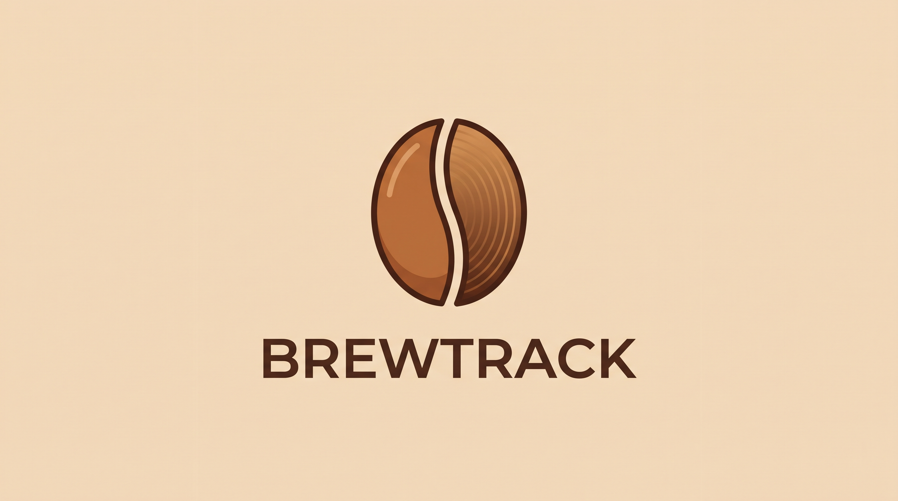
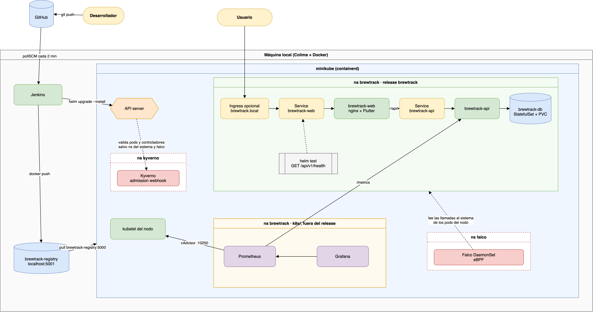
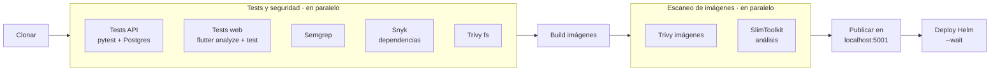

<p align="center">
  
</p>

<h1 align="center">BrewTrack</h1>

<p align="center">
  Trazabilidad de café de especialidad, del lote verde al tueste.<br>
  FastAPI · Flutter Web · PostgreSQL · Kubernetes · Helm · Jenkins · Prometheus · Grafana · Kyverno · Falco
</p>

---

## Contenido

1. [Acerca del proyecto](#1-acerca-del-proyecto)
2. [Funcionalidades](#2-funcionalidades)
3. [Stack tecnológico](#3-stack-tecnológico)
4. [Arquitectura](#4-arquitectura)
5. [Estructura del proyecto](#5-estructura-del-proyecto)
6. [Puesta en marcha](#6-puesta-en-marcha)
7. [Configuración](#7-configuración)
8. [Pipeline CI/CD](#8-pipeline-cicd)
9. [Métricas y dashboard de Grafana](#9-métricas-y-dashboard-de-grafana)
10. [Seguridad](#10-seguridad)
11. [Problemas encontrados y soluciones](#11-problemas-encontrados-y-soluciones)
12. [Conclusiones y próximos pasos](#12-conclusiones-y-próximos-pasos)
13. [Cómo contribuir](#13-cómo-contribuir)
14. [Licencia](#14-licencia)
15. [Agradecimientos](#15-agradecimientos)
16. [Autores](#16-autores)

---

## 1. Acerca del proyecto

BrewTrack lleva el registro de un taller de tueste, desde que llega el café verde hasta que sale tostado. Responde tres preguntas: cuánto café queda, de qué lote salió cada tueste y cuánto peso se perdió al tostar.

El proyecto empezó como una app con `docker compose` y hoy se despliega en Kubernetes con un Helm chart. Cada commit pasa por un pipeline de Jenkins con tests y análisis de seguridad. Prometheus y Grafana muestran el estado técnico y el del negocio, y Kyverno y Falco protegen el clúster.

**Fuera del alcance:** curvas de tueste, empaque, precios, clientes y facturación, recetas y cata, y varias empresas en una misma instalación.

---

## 2. Funcionalidades

- **Lotes de café verde:** origen (país, región, finca, productor), variedad, proceso, altitud, cosecha y kg recibidos.
- **Tuestes:** lote de origen, quién tostó, kg de verde que entraron y de tostado que salieron, duración, temperatura de descarga y nivel (`light`, `medium`, `dark`). La merma se calcula sola.
- **Stock calculado:** la app no guarda el stock, lo calcula a partir de lo recibido y lo usado. No deja tostar más de lo que queda.
- **Salidas de tostado:** venta, consumo u otro motivo, descontadas del stock de cada tueste.
- **Trazabilidad:** desde un lote se ven sus tuestes, y desde un tueste se llega a su lote.
- **Resumen mensual:** verde disponible hoy y, para el mes elegido, lo recibido, lo tostado y la merma.
- **Usuarios y roles:** `roaster` registra lotes y tuestes; `admin` además borra y gestiona usuarios. La API impone los permisos; la web solo oculta lo que el rol no puede hacer.

---

## 3. Stack tecnológico

| Capa | Tecnología |
|---|---|
| Frontend | Flutter Web (Riverpod, go_router, dio), servido por nginx |
| Backend | FastAPI, SQLAlchemy 2, Alembic, Python 3.13 |
| Base de datos | PostgreSQL 17 |
| Contenedores | Docker sobre Colima, imágenes multi-stage |
| Orquestación | Kubernetes (minikube) y Helm 3 |
| CI/CD | Jenkins, registro local de imágenes |
| Monitoreo | Prometheus 3.15.1, Grafana 12.4.13 |
| Seguridad | Semgrep, Snyk, Trivy, SlimToolkit, Kyverno 1.19.2, Falco 0.45.2 |

---

## 4. Arquitectura



**Recorrido de un pedido.** El usuario entra por el Ingress (o por un `port-forward` en dev). nginx (`brewtrack-web`) sirve la UI y reenvía `/api/` al Service `api`. La API lee y escribe en Postgres (`db`), que guarda sus datos en un PersistentVolumeClaim de 1 GiB (10 GiB en prod).

**Nombres por release.** Cada recurso lleva el nombre del release (`brewtrack-db`, `brewtrack-api`, `brewtrack-web`, `brewtrack-secrets`). Así se pueden instalar dev y prod en el mismo clúster, en namespaces distintos.

**Seguridad en dos momentos.** Kyverno revisa cada pod al llegar al API server y rechaza los que incumplen. Falco vigila lo que hacen los pods ya en marcha.

**Medidas comunes a todos los pods de la app:**
- Usuario sin privilegios (`runAsNonRoot`, uid numérico).
- Raíz de solo lectura; las carpetas que se escriben son discos en memoria (`emptyDir`).
- Sin escalada de privilegios y sin capabilities (`drop: ALL`).
- `seccompProfile: RuntimeDefault`.
- Sin token de la ServiceAccount, salvo Prometheus, que lo necesita para descubrir pods.
- `requests` y `limits` de CPU y memoria.

### 4.1 Contenedores

| Imagen | Base | Multi-stage | Usuario | Notas |
|---|---|---|---|---|
| `brewtrack-api` | `python:3.13-slim` | Sí | `app` (uid 1000) | Quita `pip` y `setuptools` de la imagen final |
| `brewtrack-web` | `ghcr.io/cirruslabs/flutter:3.44.0` → `nginx:1.30-alpine` | Sí | `nginx` (uid 101) | Escucha en 8080: un usuario sin privilegios no puede usar el 80 |
| `brewtrack-db` | `postgres:17-alpine` | No | `postgres` (uid 70) | Imagen propia solo para aplicar parches de Alpine |

Todas las versiones están fijas: ninguna imagen usa `latest`, `stable` ni una etiqueta sin versión.

**Tamaño y capas** (SlimToolkit, `reports/image-analysis.md`):

| Imagen | Tamaño | Capas | De la base | Nuestras |
|---|---|---|---|---|
| `brewtrack-db:0.1.0` | 301,1 MB | 11 | 291,1 MB | 10,1 MB |
| `brewtrack-api:0.1.0` | 280,1 MB | 8 | 143,6 MB | 136,6 MB |
| `brewtrack-web:0.2.0` | 114,7 MB | 11 | 62,0 MB | 52,8 MB |
| `brewtrack-web:0.2.0-slim` | 55,3 MB | 1 | — | — |

```
web  build  info=http.probe.summary total='4' failures='0' successful='4'
web  build  info=results status='MINIFIED' by='2.07X' size.original='115 MB' size.optimized='55 MB'
```

### 4.2 Helm chart

```
helm-chart/
├── Chart.yaml              chart brewtrack, appVersion 0.1.0
├── values.yaml             valores por defecto
├── values-dev.yaml         una réplica, datos de ejemplo, web por NodePort
├── values-prod.yaml        2 réplicas de web, más recursos, Ingress nginx
├── tests/render.sh         104 controles sobre lo que renderiza la chart
└── templates/              db, api, web, ingress, configmap, secret, helm test
```

| | `values-dev.yaml` | `values-prod.yaml` |
|---|---|---|
| Datos de ejemplo | Sí | No |
| Web | 1 réplica, `NodePort` | 2 réplicas, `ClusterIP` |
| Ingress | No | Sí, clase `nginx`, host `brewtrack.local` |
| Disco de la base | 1 GiB | 10 GiB |
| db (requests → limits) | 50m/128Mi → 1/256Mi | 250m/256Mi → 1/1Gi |
| api (requests → limits) | 50m/128Mi → 1/384Mi | 200m/256Mi → 1/512Mi |
| web (requests → limits) | 20m/32Mi → 1/64Mi | 100m/64Mi → 1/128Mi |


---

## 5. Estructura del proyecto

```
BrewTrack/
├── api/            FastAPI, Alembic, tests y Containerfile
├── web/            Flutter Web, nginx.conf y Containerfile
├── db/             Containerfile de Postgres
├── helm-chart/     chart de Kubernetes y valores por entorno
├── k8s/            Prometheus, Grafana y manifiestos sueltos
├── grafana/        dashboard exportado (dashboard.json)
├── kyverno/        políticas y casos de prueba
├── falco/          valores de instalación
├── semgrep/        reglas propias y sus tests
├── ci/             scripts que usa Jenkins (Snyk, SlimToolkit)
├── scripts/        up.sh, load.sh, down.sh y pruebas en minikube
├── reports/        informes de los análisis
├── docs/           guías de CI, seguridad y diagramas
├── Jenkinsfile     pipeline
└── compose.yaml    entorno local con Docker Compose
```

---

## 6. Puesta en marcha

### 6.1 Requisitos

Colima (o Docker Desktop), `kubectl`, `minikube`, `helm` 3, Flutter 3.44 y Python 3.12 o más nuevo para desarrollo.

### 6.2 Local con Docker Compose

```bash
cp .env.example .env   # completar POSTGRES_PASSWORD, JWT_SECRET y SEED_ADMIN_PASSWORD
docker compose up --build -d
```

Abrir http://localhost:8081 y entrar con `SEED_ADMIN_EMAIL` y `SEED_ADMIN_PASSWORD`. La API crea ese admin al arrancar si la base no tiene usuarios. Otra opción:

```bash
docker compose exec api python -m app.cli create-admin --email tu@correo.dev --name "Tu Nombre"
```

### 6.3 Kubernetes con minikube

Tres scripts cubren todo el ciclo, incluida la instalación de los operadores (ingress-nginx, Kyverno y Falco):

```bash
bash scripts/up.sh       # clúster, registro, imágenes, operadores, BrewTrack, admin y monitoreo
bash scripts/load.sh     # tráfico durante 5 minutos para llenar los dashboards
bash scripts/down.sh     # borra todo (--all también borra el registro y minikube)
```

La **[guía paso a paso](docs/guia-paso-a-paso.md)** explica cada comando y muestra el resultado de cada etapa. Resumen:

| # | Comando | Resultado esperado |
|---|---|---|
| 1 | `colima start` y `minikube start --driver=docker --container-runtime=containerd` | `minikube status` en `Running` |
| 2 | `minikube addons enable ingress` | `ingress-nginx-controller` en `Running` |
| 3 | `bash scripts/registry-up.sh` | `listo: el nodo llega a http://brewtrack-registry:5000` |
| 4 | Correr el pipeline de Jenkins, o `docker build` y `docker push` a `localhost:5001` | imágenes en el registro |
| 5 | `bash scripts/kyverno-up.sh` | `listo: Kyverno ya rechaza pods que incumplen` |
| 6 | `helm install brewtrack ./helm-chart -n brewtrack --create-namespace -f helm-chart/values-dev.yaml` | `brewtrack-db-0`, `brewtrack-api-…`, `brewtrack-web-…` en `Running` |
| 7 | `helm test brewtrack -n brewtrack` | `Phase: Succeeded` |
| 8 | `kubectl -n brewtrack port-forward svc/brewtrack-web 8081:8080 &`<br>`kubectl -n brewtrack port-forward svc/grafana 3000:3000 &`<br>`kubectl -n brewtrack port-forward svc/prometheus 9090:9090 &`<br>(se cierran con `pkill -f "kubectl -n brewtrack port-forward"`) | web en http://localhost:8081, Grafana en http://localhost:3000, Prometheus en http://localhost:9090 |
| 9 | `bash scripts/monitoring-up.sh` | Prometheus y Grafana en `Running` |
| 10 | `bash scripts/load.sh` | paneles con datos en http://localhost:3000 |
| 11 | `bash scripts/kyverno-validate.sh` | `Resumen: 7 OK, 0 fallas` |
| 12 | `bash scripts/falco-up.sh` y `bash scripts/falco-event.sh` | 3 alertas WARNING |
| 13 | `bash scripts/semgrep-scan.sh` | `1 finding` (falso positivo) |
| 14 | `bash scripts/snyk-scan.sh` (token guardado una vez con `snyk auth`) | `reports/snyk-report.txt` |

### 6.4 Desarrollo

```bash
docker compose up -d db                       # solo la base
cd api && . .venv/bin/activate && pytest      # tests de la API (Postgres de pruebas en 55432)
cd api && uvicorn app.main:app --reload       # con DATABASE_URL y JWT_SECRET en el entorno
cd web && flutter run -d chrome --web-port 5000 --dart-define=API_BASE=http://localhost:8000/api/v1
cd web && flutter test
```

### 6.5 Puertos

| Puerto | Servicio |
|---|---|
| 8080 / 50000 | Jenkins |
| 8081 | web (compose o `port-forward`) |
| 8000 | API en desarrollo |
| 5000 | Frontend en desarrollo |
| 5001 | Registro local de imágenes |
| 55432 | Postgres de pruebas |
| 3000 | Grafana (`port-forward`) |
| 9090 | Prometheus (`port-forward`) |

---

## 7. Configuración

Toda la configuración entra por variables de entorno. `.env` no se versiona; la plantilla es `.env.example`.

| Variable | Uso |
|---|---|
| `POSTGRES_PASSWORD` | Clave de la base. Solo caracteres seguros para URL (`openssl rand -hex 24`). |
| `JWT_SECRET` | Firma de los tokens. Mínimo 32 caracteres y distinto del ejemplo; si no, la API no arranca. `openssl rand -hex 32`. |
| `DATABASE_URL` | Conexión a Postgres (en compose y en la chart se arma sola). |
| `TIMEZONE` | Zona horaria del taller; define dónde empieza cada mes en el resumen. |
| `SEED_DEMO_LOTS` | `true` carga 20 lotes y 24 tuestes de ejemplo si la base está vacía. |
| `SEED_ADMIN_EMAIL`, `SEED_ADMIN_PASSWORD` | Primer admin, creado al arrancar si no hay usuarios. Clave de 8 caracteres o más. |

En Kubernetes, la chart genera el Secret con claves al azar y las conserva en cada `upgrade`, o usa uno propio con `existingSecret`. La tabla completa de valores está en `helm-chart/README.md`.

**Backup:**

```bash
docker compose exec db pg_dump -U brewtrack brewtrack > backup-$(date +%F).sql
```

---

## 8. Pipeline CI/CD

El `Jenkinsfile` corre en cada cambio de `master`. Jenkins consulta el repo cada 2 minutos, porque corre en localhost y GitHub no puede avisarle. Si una etapa falla, las siguientes no corren. Guía completa: `docs/ci/jenkins.md`.



| # | Etapa | Herramienta | Corta el pipeline si… | Deja |
|---|---|---|---|---|
| 1 | Clonar | git | no puede clonar | commit, autor y mensaje |
| 2a | Tests API | pytest + Postgres 17 | falla un test | `api/pytest.xml` |
| 2b | Tests web | `flutter analyze` + `flutter test` | hay errores o falla un test | log |
| 2c | Semgrep | reglas de la comunidad + reglas propias | hay cualquier hallazgo | `reports/semgrep-report.txt` |
| 2d | Snyk | Snyk CLI | hay una vulnerabilidad **crítica** | `reports/snyk-report.txt` |
| 2e | Trivy fs | Trivy (vulnerabilidades, secretos, configuración) | HIGH o CRITICAL con arreglo | log |
| 3 | Build | `docker build` | falla una compilación | tamaño de cada imagen |
| 4a | Trivy imágenes | Trivy | HIGH o CRITICAL con arreglo | `reports/trivy-images-report.txt` |
| 4b | SlimToolkit | `slim xray` de `db`, `api` y `web` | nunca (amarillo si falla) | `reports/slimtoolkit/` |
| 5 | Publicar | `docker push` al registro local | el registro no responde | imágenes `versión-commit` |
| 6 | Deploy | `helm upgrade --install --wait` y `helm test` | un pod no queda listo en 5 min | `helm status`, test, historial y pods |

- **Etiquetas por commit.** Cada build publica, por ejemplo, `brewtrack-api:0.1.0-<commit>`. Con una etiqueta repetida y `imagePullPolicy: IfNotPresent`, el nodo seguiría usando la imagen vieja.
- **Registro local.** Jenkins publica en `localhost:5001` y los pods bajan de `brewtrack-registry:5000`, el mismo contenedor visto desde la red de minikube.
- **Paralelo sin `failFast`.** Si Semgrep falla, Snyk y Trivy terminan igual: una corrida muestra todos los problemas.
- **Corte por vulnerabilidades.** Semgrep corre con `--error`, Snyk con `--severity-threshold=critical` y Trivy con `--exit-code 1`. Cualquiera detiene el pipeline antes de construir y desplegar.


---

## 9. Métricas y dashboard de Grafana

### 9.1 Instrumentación de la API

La API publica `/metrics` en formato Prometheus. Ese endpoint queda fuera de `/api/`, así que nginx no lo expone.

- **HTTP:** `prometheus-fastapi-instrumentator` genera `http_requests_total` (por ruta, método y código) y el histograma `http_request_duration_seconds`.
- **Negocio:** definidas en `api/app/metrics.py`.

| Métrica | Tipo | Qué mide |
|---|---|---|
| `brewtrack_green_stock_kg` | gauge | Kg de verde disponibles. Se calcula en cada scrape con una consulta, no se guarda. |
| `brewtrack_green_lots_with_stock` | gauge | Lotes con stock mayor a cero |
| `brewtrack_roasts_created_total{roast_level}` | contador | Tuestes registrados |
| `brewtrack_roast_green_in_kg_total` | contador | Kg de verde que entraron al tostador |
| `brewtrack_roast_out_kg_total` | contador | Kg de tostado que salieron |

Si la base no responde, `/metrics` sigue entregando las métricas HTTP y omite las de negocio.

### 9.2 Prometheus

`k8s/prometheus.yaml` despliega Prometheus con una ServiceAccount de solo lectura y dos fuentes:

- **`api`:** cada pod de la API, descubierto por la etiqueta `app.kubernetes.io/component=api`. Sigue andando si se agregan réplicas.
- **`kubernetes-cadvisor`:** CPU y memoria de cada contenedor del namespace `brewtrack`, desde el kubelet.

### 9.3 Dashboard

Grafana usa Prometheus como fuente y carga el dashboard exportado en [`grafana/dashboard.json`](grafana/dashboard.json): 22 paneles en 4 secciones.

| Sección | Paneles | Consulta principal |
|---|---|---|
| Resumen | API arriba, pedidos por segundo, latencia, errores 5xx, logins fallidos, stock verde | `sum(rate(http_requests_total{job="api", handler!="/metrics"}[1m]))` |
| Tráfico y latencia | Pedidos por ruta y código; latencia promedio y p95 | `rate(http_request_duration_seconds_sum[1m]) / rate(http_request_duration_seconds_count[1m])` |
| Recursos por pod | CPU y memoria por pod | `sum by (pod) (rate(container_cpu_usage_seconds_total{namespace="brewtrack"}[1m]))` |
| Negocio | Tuestes por hora, kg tostados, merma, lotes con stock, stock en el tiempo, tuestes por nivel | `100 * (1 - increase(brewtrack_roast_out_kg_total[24h]) / increase(brewtrack_roast_green_in_kg_total[24h]))` |

**Tráfico de prueba.** `scripts/load.sh` genera unos 5 pedidos por segundo durante 5 minutos: lecturas, un tueste cada 20 pedidos, logins fallidos y 404. Resultado de una corrida de 12 segundos con un lote nuevo de 300 kg:

| Resultado | Valor |
|---|---|
| Pedidos | 223 |
| Tuestes nuevos | 11 |
| `brewtrack_roast_green_in_kg_total` | 117 kg |
| `brewtrack_roast_out_kg_total` | 97,339 kg → merma 16,8 % |
| `brewtrack_green_stock_kg` | 183 kg (300 − 117) |


---

## 10. Seguridad

La seguridad trabaja en tres capas: antes del build (Semgrep, Snyk, Trivy), al entrar al clúster (Kyverno) y en ejecución (Falco).

| Herramienta | Qué revisa | Resultado |
|---|---|---|
| Semgrep | Código, Containerfiles, YAML, nginx, secretos | 37 hallazgos → **1**, un falso positivo justificado. Encontró un bug real. |
| Snyk | Dependencias de la API | **0** vulnerabilidades en 36 dependencias (pip-audit coincide) |
| Trivy | Repo e imágenes | Sin HIGH ni CRITICAL con arreglo publicado. Riesgo aceptado: `gosu` en `db` |
| Kyverno | Pods al entrar al clúster | 4 políticas en modo Deny; la chart, Prometheus y Grafana las cumplen |
| Falco | Pods en ejecución | Detecta la búsqueda de credenciales dentro del pod de la API |

### 10.1 Semgrep

`scripts/semgrep-scan.sh` → [`reports/semgrep-report.txt`](reports/semgrep-report.txt). Detalle: [`reports/semgrep-hallazgos.md`](reports/semgrep-hallazgos.md).

Reglas propias (`semgrep/python-security.yaml`) para Python y el stack de la API:

| Regla | Detecta | CWE |
|---|---|---|
| `brewtrack-jwt-decode-sin-verificar` | `jwt.decode` sin `algorithms`, sin firma o con `none` | CWE-347 |
| `brewtrack-sql-armado-con-texto` | SQL con f-string, `%`, `.format` o `+` | CWE-89 |
| `brewtrack-like-sin-escape` | patrones LIKE armados con datos del usuario | CWE-943 |
| `brewtrack-hash-debil-para-claves` | MD5 y SHA-1 | CWE-327 |
| `brewtrack-secreto-en-log` | secretos o tokens en `print` o `log.*` | CWE-532 |

```
===== 1. Prueba de las reglas propias (semgrep --test)
5/5: ✓ All tests passed

===== 2. Escaneo del repo
✅ Scan completed successfully.
 • Findings: 1 (1 blocking)
 • Rules run: 698
 • Targets scanned: 153
```

| Hallazgo | Qué hicimos |
|---|---|
| `brewtrack-like-sin-escape` en el filtro de lotes | **Corregido.** Con `?country=%` la API devolvía todos los lotes. Ahora usa `icontains(…, autoescape=True)` y un test de regresión. |
| `no-fractional-cpu-limits` (8 líneas) | **Corregido.** Límites de 0,2 y 0,5 núcleos frenaban los procesos aunque sobrara CPU. El límite pasó a 1 núcleo. |
| `metadata-*` en las reglas propias | **Corregido.** Se agregó la metadata estándar (`owasp`, `confidence`, `impact`). |
| `facebook-page-access-token` en `pubspec.lock` | **Falso positivo.** Es el hash sha256 de un paquete de Dart. |

### 10.2 Snyk

`scripts/snyk-scan.sh` (token: `snyk auth` una vez, o `SNYK_TOKEN`) → `reports/snyk-report.txt`. Análisis y correcciones: [`reports/snyk-analisis.md`](reports/snyk-analisis.md).

Snyk analiza las versiones exactas que instala la imagen (`pip freeze` después de `pip install ./api`), no los rangos de `pyproject.toml`. Con una vulnerabilidad crítica, la etapa falla y no se construye ni se despliega nada.

```
Testing  (requirements-snyk.txt) ...

Tested 36 dependencies for known issues, found 0 issues, 0 vulnerable paths.

│   Project name:      brewtrack-api                                    │
│   Target file:       requirements-snyk.txt                            │
│   Total security issues: 0                                            │

Sin vulnerabilidades críticas: el pipeline sigue.
```

pip-audit, contra la base de PyPI, da lo mismo: `No known vulnerabilities found`.

**Correcciones propuestas:** subir el mínimo de la dependencia afectada a la versión arreglada; generar un lockfile con hashes para escanear lo mismo que se despliega; pasar la API a una imagen base mínima (distroless o Chainguard).

### 10.3 Trivy

| Imagen | Antes | Después |
|---|---|---|
| `brewtrack-web` (Alpine) | 1 CRITICAL, 5 HIGH | 0 |
| `brewtrack-api` (paquetes de Python) | 5 HIGH | 0 |
| `brewtrack-api` (Debian) | 48 HIGH | 47 HIGH, ninguno con arreglo publicado |
| `brewtrack-db` (Alpine) | 18 HIGH | 0 |
| `brewtrack-db` (`gosu`) | 1 CRITICAL, 25 HIGH | Riesgo aceptado (`docs/security/2026-11-10-imagen-db.md`) |

### 10.4 Kyverno

`scripts/kyverno-up.sh` instala Kyverno y aplica `kyverno/policies/`. `scripts/kyverno-validate.sh` prueba los casos de `kyverno/tests/` y escribe `reports/kyverno-validation.log`. Guía: `docs/security/kyverno.md`.

| # | Política (Deny) | Rechaza | Mensaje |
|---|---|---|---|
| 01 | `brewtrack-disallow-latest-tag` | imágenes `:latest` o sin etiqueta | "La etiqueta latest no está permitida: usa una versión fija." |
| 02 | `brewtrack-require-requests-limits` | contenedores sin `requests` y `limits` | "Cada contenedor necesita resources.requests y resources.limits de cpu y memory." |
| 03 | `brewtrack-require-run-as-non-root` | `runAsNonRoot` ausente o `runAsUser: 0` | "runAsUser 0 es root y no está permitido." |
| 04 | `brewtrack-disallow-privilege-escalation` | contenedores `privileged` o con escalada | "Los contenedores privileged no están permitidos." |

Revisan pods y todo lo que crea pods: un Deployment que incumple se rechaza al crearlo, y `helm install` falla con el mensaje. Quedan fuera los namespaces del sistema, `kyverno`, `ingress-nginx` y `falco` (Falco necesita correr privilegiado).

| Caso de prueba | Esperado |
|---|---|
| `pod-ok.yaml` | admitido |
| `pod-latest.yaml`, `pod-sin-etiqueta.yaml` | rechazado por 01 |
| `pod-sin-limites.yaml` | rechazado por 02 |
| `pod-root.yaml` | rechazado por 03 |
| `pod-privilegiado.yaml` | rechazado por 04 |
| `deployment-malo.yaml` | rechazado por 01 y 02 |


### 10.5 Falco

`scripts/falco-up.sh` instala Falco con el driver `modern_ebpf` y alertas en JSON. `scripts/falco-event.sh` dispara el evento y escribe `reports/falco-event.log`. Guía: `docs/security/falco.md`.

**Evento.** Simula a alguien que logró ejecutar comandos dentro del contenedor de la API y busca llaves SSH y credenciales de AWS (MITRE ATT&CK T1552). La API solo corre `uvicorn`, así que un `find` de llaves en su contenedor es sospechoso aunque no encuentre nada.

| Comando en el pod `api` | Regla de Falco | Prioridad |
|---|---|---|
| `find / -xdev -name id_rsa` | Search Private Keys or Passwords | WARNING |
| `grep -rl "BEGIN RSA PRIVATE" /etc /srv` | Search Private Keys or Passwords | WARNING |
| `find / -xdev -path "*/.aws/credentials"` | Find AWS Credentials | WARNING |


---

## 11. Problemas encontrados y soluciones

| # | Problema | Solución |
|---|---|---|
| 1 | Los YAML viejos de `k8s/` dejarían una segunda base corriendo junto a la chart. | El pipeline los detecta antes de desplegar y corta con el comando para borrarlos, en vez de borrar datos sin avisar. |
| 2 | Hubo dos Helm charts en ramas paralelas que chocaban en `helm-chart/`. | Nos quedamos con la que tenía nombres por release, `helm test` y prueba de render, y le sumamos lo que pide Kyverno. |
| 3 | Misma etiqueta en cada build e `imagePullPolicy: IfNotPresent`: el nodo seguía con la imagen vieja. | Etiqueta `versión-commit` en cada build. |
| 4 | El registro local habla HTTP y containerd exige HTTPS. El puerto 5000 lo usan AirPlay y `flutter run`. | `registry-up.sh` declara el registro en containerd del nodo. Publicamos en el 5001. |
| 5 | Imágenes con `flutter:stable`, `nginx:alpine` o etiquetas de rama: dos builds del mismo commit podían diferir. | Versiones fijas, y Kyverno rechaza `latest` y las imágenes sin etiqueta. |
| 6 | Ningún pod tenía límites de CPU ni memoria, tampoco el de `helm test`. | Límites por defecto en la chart, Prometheus y Grafana antes de activar Kyverno. `tests/render.sh` lo controla. |
| 7 | Kyverno en Deny en todo el clúster habría bloqueado los pods del sistema y a Falco. | Excluimos esos namespaces de las cuatro políticas. |
| 8 | Prometheus contaba sus pedidos a `/metrics` como tráfico de la API. | Las consultas filtran `handler!="/metrics"`. |
| 9 | Los contadores vuelven a cero al reiniciar el pod, y el stock no se puede guardar. | El stock es un gauge calculado en cada scrape. Los contadores se usan con `rate()` e `increase()`, que toleran el reinicio. |
| 10 | El filtro de lotes no escapaba los comodines de LIKE. | `icontains(…, autoescape=True)` y un test de regresión. |
| 11 | Con límites de CPU fraccionarios, Kubernetes frena el proceso aunque el nodo tenga CPU libre. | Límite de 1 núcleo; la reserva la fijan los `requests`. |
| 12 | `semgrep.dev` y Snyk no siempre responden desde el entorno de trabajo. | Las reglas de la comunidad se clonan desde GitHub y las propias viven en el repo. pip-audit sirve de control cruzado. |
| 13 | Trivy fs habría cortado el pipeline por los manifiestos que incumplen a propósito (casos de Kyverno). | `--skip-dirs kyverno/tests` en Trivy y `--exclude` en Semgrep. |
| 14 | La API corre las migraciones al arrancar: con varias réplicas correrían a la vez. | `api.replicas` queda en 1. La solución de fondo está en los próximos pasos. |
| 15 | SlimToolkit no lee imágenes del almacén containerd del Docker del host y su sensor necesita `fanotify`. | `ci/slimtoolkit.sh` levanta un dockerd desechable y corre ahí `xray` y `build`. |

---

## 12. Conclusiones y próximos pasos

**Conclusiones**

- El proyecto pasó de `docker compose` a un despliegue reproducible en Kubernetes. Una misma chart sirve para dev y prod, y cada commit recorre el mismo camino: tests, análisis, build, escaneo, publicación y despliegue.
- Las tres capas de seguridad se complementan. Kyverno no ve lo que pasa dentro de un pod, y Falco no impide que un pod mal configurado arranque.
- El dashboard junta el estado técnico (pedidos, latencia, CPU, memoria) con el del negocio (stock, tuestes, merma). Una merma fuera de lo normal se ve en el mismo lugar que un pico de errores.
- Las herramientas encontraron problemas reales: Semgrep, un bug en el filtro de lotes; Trivy, paquetes vulnerables en las tres imágenes; y preparar Kyverno mostró que ningún pod tenía límites.

**Oportunidades de mejora**

| Mejora | Por qué |
|---|---|
| Migraciones en un `Job` de Helm (`pre-upgrade`) | Permite más de una réplica de la API. |
| Lockfile de Python con hashes | Se escanea exactamente lo que se despliega. |
| Imagen base mínima para la API | Quita la mayoría de los 47 avisos de Debian y deja la imagen sin shell. |
| Alertas con Alertmanager y Falcosidekick | Hoy las alertas se ven solo si alguien mira Grafana o los logs. |
| `kube-state-metrics` | Uso de cada pod contra su límite y reinicios en el dashboard. |
| Firmar imágenes con cosign y verificarlas con Kyverno | En el clúster solo corre lo que publicó Jenkins. |
| Sealed Secrets o External Secrets | Hoy el Secret de prod se crea a mano. |
| Webhook de GitHub | Despliegues más rápidos que consultar cada 2 minutos. |
| Stock tostado en las métricas | Completa el panel de negocio. |
| Blue/green en la chart | Volver a la UI anterior con un `helm upgrade`. |

---

## 13. Cómo contribuir

1. Abrí un issue en GitHub describiendo el cambio.
2. Creá una rama desde `master` (`feat/…` o `fix/…`).
3. Usá Conventional Commits con el área como alcance: `feat(api): …`, `fix(web): …`, `docs: …`.
4. Cada cambio trae sus tests: en la API (auth y roles, stock y merma, restricciones) y en la web (formularios y visibilidad por rol).
5. Antes de abrir el PR: `cd web && flutter analyze`, `cd api && pytest`, `cd web && flutter test`.
6. El esquema solo cambia con migraciones Alembic nuevas; nunca se edita una ya aplicada.
7. Abrí el PR contra `master`. Jenkins corre el pipeline completo al fusionarlo.

Reglas del proyecto: `AGENTS.md`.

---

## 14. Licencia

Proyecto académico sin licencia de código abierto. Todos los derechos quedan reservados a sus autores.

---

## 15. Agradecimientos

- A los proyectos de código abierto sobre los que corre BrewTrack: FastAPI, Flutter, PostgreSQL, Kubernetes, Helm, Jenkins, Prometheus, Grafana, Kyverno, Falco, Semgrep, Trivy y SlimToolkit.
- A Snyk, por el acceso gratuito a su análisis de dependencias.
- A la comunidad de `semgrep-rules`, por las reglas que usa el pipeline.

---

## 16. Autores

- **Federico Pizarro** — [@fedepds](https://github.com/fedepds)
- **Lucas Giffuni**
